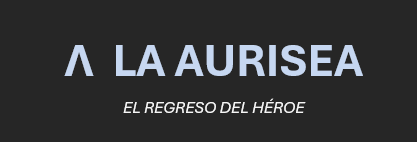
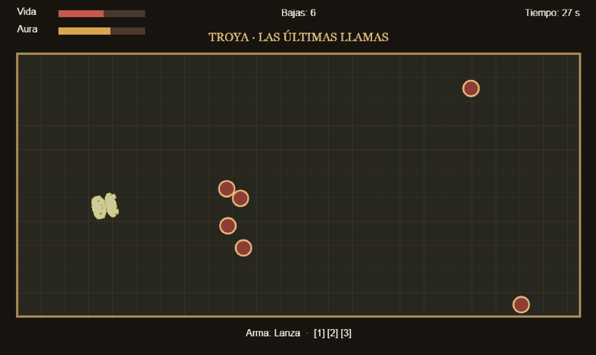

# ***La Aurisea***

Documento de diseño de videojuego (GDD)
- Ligero Productions
- https://github.com/theligero/la-aurisea
- Versión 2.0 – 2 de noviembre de 2026

| Resumen: Odiseo regresa a Ítaca tras la guerra de Troya y debe sobrevivir a las amenazas de su viaje. |  |
| :---- | :---- |
| Géneros: 2D Horde / Arena Survival | Modos: Un jugador |
| Público objetivo: Público general interesado en acción arcade y mitología. Edad, sexo, región e idioma: sin segmentación excluyente; interfaz en español. | Plataformas: PC / ChromiumRequisitos: navegador compatible y equipo capaz de ejecutar Phaser 3\. |
| Cantidades: 6 escenarios, 3 armas, 1 protagonista. Varias familias de enemigos. | Hitos: Concepto y GDD inicial: septiembre de 2026 Rediseño Hito 2: octubre de 2026. Producción: según planificación académica. Lanzamiento: no definido |

## **Descripción**

La Aurisea es un videojuego 2D de acción y supervivencia por oleadas inspirado libremente en episodios de la Odisea de Homero. El jugador controla a Odiseo durante su regreso a Ítaca y se enfrenta a enemigos vinculados a los lugares y criaturas de su viaje. La propuesta conserva el planteamiento original de supervivencia y el medidor de aura, pero amplía el combate con una tercera arma y convierte el campo de juego en una arena cenital donde las amenazas pueden llegar desde distintas direcciones.  
El proyecto mantiene un alcance deliberadamente acotado para su desarrollo en Phaser 3: un jugador, arenas cerradas, cámara fija, enemigos con comportamientos sencillos y seis escenarios diferenciados principalmente por su ambientación, composición de enemigos y condiciones de combate. La adaptación toma licencias respecto al poema para convertir episodios narrativos en encuentros jugables.

| Logotipo y portada del juego |
| ----- |
|  |

# **Aspectos generales**

La experiencia propuesta conserva la esencia de La Aurisea: sobrevivir a sucesivas amenazas durante el viaje de Odiseo hacia Ítaca. El cambio principal respecto a la versión anterior es espacial y no narrativo: en lugar de recibir enemigos únicamente por la derecha, Odiseo se sitúa aproximadamente en el centro de una arena y puede desplazarse libremente en ocho direcciones. Los enemigos aparecen desde distintos puntos del perímetro y avanzan hacia él.  
El jugador debe gestionar tres armas complementarias. La espada es eficaz a corta distancia, la lanza permite atacar en línea recta a distancia intermedia y el arco permite eliminar amenazas desde lejos mediante proyectiles. El medidor de aura continúa siendo un elemento central: aumenta al derrotar enemigos y disminuye al recibir impactos.  
La estructura sigue siendo de un jugador y por escenarios. Los niveles alternan supervivencia por tiempo, encuentros especiales y un desafío final con reglas propias. La ambientación y los enemigos cambian para representar episodios del viaje, sin exigir sistemas completamente distintos en cada fase.

| Vista general |
| ----- |
|  *Esquema conceptual: Odiseo en el centro y entradas de enemigos distribuidas por el perímetro.* |

## **Relato breve y parcial de una partida típica** 

Al comenzar una fase, Odiseo aparece en el centro de la arena. Los primeros enemigos entran desde los límites del escenario y avanzan hacia él. El jugador se desplaza con WASD, orienta el ataque con el ratón y cambia de arma según la distancia y la disposición de los adversarios. Si varios enemigos se aproximan, puede utilizar la espada para responder a corta distancia; si se alinean, la lanza permite atravesarlos; si una amenaza permanece alejada, el arco ofrece una respuesta a distancia.  
Cada baja contribuye al aura y a la puntuación. Recibir daño reduce la vida y también parte del aura acumulada. En los escenarios estándar, el objetivo consiste en resistir hasta que termine el tiempo y alcanzar el umbral de aura. En Ítaca, el combate final limita a Odiseo al arco, pero le concede flechas ilimitadas para que la dificultad dependa del apuntado y del posicionamiento.

# **Jugabilidad**

La jugabilidad se organiza alrededor de cuatro acciones constantes: moverse, orientarse, atacar y elegir el arma adecuada. La cámara fija permite observar la arena completa y anticipar la aproximación de enemigos desde diferentes direcciones. El sistema reutiliza familias de comportamiento para mantener el alcance de producción controlado.

## **Mecánica**

   ### **Mecánicas del personaje**

Odiseo puede moverse en ocho direcciones mediante `W`, `A`, `S`, `D`, o las flechas. El movimiento diagonal debe normalizarse para que no resulte más rápido que el horizontal o vertical. No se contempla salto. El personaje dispone de una barra de vida y de un medidor de aura independientes.  
El combate dispone de tres armas seleccionables: espada, lanza y arco. La espada ejecuta un ataque corto en arco frente al personaje; la lanza realiza una estocada lineal de alcance medio que puede atravesar enemigos alineados; el arco dispara un proyectil en la dirección de apuntado. Cada ataque tiene un tiempo de reutilización para evitar que pueda ejecutarse de forma ilimitada e instantánea.  
Cuando Odiseo recibe un impacto, pierde vida y parte del aura acumulada. Se recomienda una breve ventana de invulnerabilidad tras el daño, acompañada de parpadeo o cambio de color, para que los impactos simultáneos no resulten injustos. Al llegar la vida a cero, la partida termina.

### **Mecánicas de escenario**

Cada nivel se desarrolla en una arena cerrada con límites que impiden abandonar el área de juego. Los enemigos aparecen desde puntos distribuidos por el perímetro; el sistema debe evitar que aparezcan directamente encima de Odiseo o a una distancia que haga inevitable recibir daño. Los escenarios pueden incluir elementos decorativos, pero no se requieren obstáculos complejos ni destrucción del entorno.  
Los enemigos se agrupan por comportamiento: perseguidores que avanzan hacia Odiseo, enemigos de alcance que disparan proyectiles, enemigos rápidos con poca resistencia, enemigos resistentes y jefes con ataques anunciados. Algunos escenarios incorporan zonas de peligro temporales, resueltas mediante indicadores visuales y áreas de impacto sencillas.

### **Controles**

WASD o flechas: movimiento. Ratón: orientación del personaje y dirección del ataque. Clic izquierdo: atacar. Teclas 1, 2 y 3: seleccionar espada, lanza y arco, respectivamente. ESC: pausar. El cambio de arma debe ser inmediato y quedar reflejado en el HUD.

### **Cámara**

La cámara es fija y cenital (top-down), mostrando la arena completa durante el combate. No sigue a Odiseo. El encuadre debe permitir distinguir al jugador, enemigos y proyectiles, así como anticipar entradas desde cualquier lado de la pantalla. La escala de los sprites y el tamaño del escenario se ajustarán para mantener una lectura clara.

## **Dinámica**

En los escenarios estándar, el jugador debe sobrevivir hasta que finalice el temporizador y alcanzar el umbral mínimo de aura establecido para esa fase. El aura aumenta al derrotar enemigos y disminuye al recibir daño. Si la vida llega a cero, se produce la derrota. La puntuación se calcula principalmente a partir de los enemigos eliminados y es independiente del requisito de aura.  
El sexto escenario funciona de manera diferente: no utiliza el temporizador habitual, sino un conjunto finito de oleadas. La victoria se obtiene al derrotar a todos los pretendientes. La espada y la lanza quedan deshabilitadas y el arco dispone de munición ilimitada. La cadencia de disparo se mantiene para que el jugador deba apuntar y reposicionarse.

## **Estética**

Se propone abandonar la animación manual de stickmans y utilizar sprites 2D existentes, preferiblemente pertenecientes a un mismo pack o a packs de estilo compatible. Se priorizará una perspectiva cenital y animaciones básicas de reposo, desplazamiento, ataque, daño y muerte. La ambientación debe evocar la mitología griega mediante fondos, arquitectura, vegetación y paletas diferenciadas para cada localización.  
La coherencia visual tiene prioridad sobre la cantidad de recursos. Antes de integrar un asset se comprobarán su licencia, autoría, resolución y compatibilidad con el resto del juego. Se consideran fuentes de búsqueda itch.io Game Assets, OpenGameArt, Kenney y CraftPix; no se presupone que todos sus recursos sean gratuitos ni que compartan licencia.

# **Menús y modos de juego** 

La Aurisea es una experiencia para un jugador. El menú principal ofrecerá iniciar partida, opciones y créditos. Si el alcance lo permite, podrá añadirse selección de nivel para pruebas. Durante la partida habrá pausa, reintento y retorno al menú. Tras completar un nivel se mostrará el resultado y la posibilidad de continuar; tras la derrota, la opción de reintentar.

## **Configuración**

La configuración mínima contempla volumen general, música y efectos de sonido. La resolución se adaptará al tamaño de la ventana del navegador. La reasignación de controles y opciones avanzadas de accesibilidad quedan como mejoras opcionales.

## **Interfaz y control**  

El HUD mantiene el medidor de aura en la parte superior izquierda y el temporizador en la parte superior derecha. Se añade o hace explícita una barra de vida para comunicar el daño recibido. En la zona inferior se mostrará el arma equipada y, cuando proceda, la munición disponible. En las fases estándar, el contador superior indica el tiempo restante; en Ítaca puede sustituirse por el número de oleada o enemigos restantes.  
La interfaz debe dejar claro qué arma está seleccionada. En el último nivel, el arco mostrará munición ilimitada y las ranuras de espada y lanza aparecerán deshabilitadas. El feedback de daño incluirá reducción de vida, cambio visual del personaje y sonido.

# **Contenido**

Los recursos necesarios incluyen sprites de Odiseo y enemigos, fondos o tilesets para seis localizaciones, proyectiles, efectos visuales de impacto y ataques, iconos de HUD, música ambiental y efectos de sonido. Se priorizarán recursos reutilizables y coherentes entre sí. Se mantendrá un registro de autor, URL y licencia de cada recurso externo.

## **Historia**

La Aurisea adapta libremente el regreso de Odiseo desde Troya hasta Ítaca. Tras diez años de guerra, el héroe emprende el viaje de vuelta, pero su camino queda interrumpido por criaturas, fuerzas sobrenaturales y peligros del mar. La idea del aura se conserva como representación simbólica del desgaste del viaje y de la esperanza de recuperar el hogar.  
La campaña selecciona episodios reconocibles y los convierte en encuentros de supervivencia. No se pretende reproducir literalmente el poema: algunos acontecimientos que en Homero son pruebas de navegación, astucia o resistencia se reinterpretan como arenas de combate. El viaje culmina en Ítaca, donde Odiseo encuentra su palacio ocupado por los pretendientes de Penélope y debe recuperar su hogar.

## **Niveles**

La campaña se compone de seis escenarios. Los cinco primeros conservan la estructura de supervivencia por tiempo y aura, con particularidades de enemigos o ataques; el último introduce una condición de victoria y una restricción de armamento específicas.

- **Troya — Las últimas llamas**. Arena introductoria entre ruinas y restos de la ciudad. Aparecen soldados básicos, lanceros y arqueros. Se habilitan espada, lanza y arco. Las oleadas son de baja densidad y enseñan movimiento, cambio de arma, daño y aura. Victoria: sobrevivir al temporizador y alcanzar el umbral de aura.  
- **La cueva de Polifemo — Nadie**. Cueva rocosa que sirve de escenario para el primer enfrentamiento especial. Polifemo actúa como jefe resistente, con un golpe frontal o de área anunciado antes de ejecutarse y una breve ventana de recuperación. Se mantienen las tres armas. Victoria: derrotar a Polifemo y completar el encuentro.  
- **Las Sirenas** — El canto de la perdición. Arena marítima o cubierta de una embarcación. Las Sirenas atacan desde la distancia y pueden aplicar una ralentización breve o generar una zona de peligro anunciada; criaturas marinas menores presionan al jugador. Se mantienen las tres armas. Victoria: superar las oleadas y alcanzar el aura mínima antes de acabar el tiempo.   
- **Eea — La isla de Circe**. Claro de bosque encantado con ruinas y elementos alquímicos. Circe alterna proyectiles mágicos con invocaciones de criaturas transformadas. Sus ataques de zona se anuncian visualmente. Se mantienen las tres armas. Victoria: derrotar a Circe y a las criaturas activas.   
- **Escila y Caribdis — Entre dos peligros**. Arena costera o cubierta de barco junto a un estrecho. Escila genera golpes rápidos en zonas concretas y Caribdis crea un remolino representado mediante un área temporal de atracción o daño. Se mantienen las tres armas. Victoria: resistir la fase de mayor presión y alcanzar el aura mínima.   
- **Ítaca — El salón de los pretendientes**. Interior del palacio con columnas y mobiliario griego. Aparecen pretendientes comunes, armados y resistentes en oleadas finitas. Odiseo solo puede utilizar el arco, pero dispone de flechas ilimitadas. No hay temporizador de supervivencia estándar. Victoria: eliminar a todos los pretendientes. 

## **Personajes y enemigos**

Odiseo es el único personaje controlable. Su conjunto mínimo de animaciones comprende reposo, desplazamiento, ataque, recepción de daño y muerte. Debe ser reconocible frente a los enemigos y mantener una orientación coherente con el apuntado.  
Las familias de enemigos se definen por comportamiento y pueden reutilizarse en diferentes escenarios: (1) perseguidor básico, que avanza directamente hacia Odiseo; (2) enemigo de alcance, que mantiene distancia y dispara; (3) enemigo rápido, que se aproxima con mayor velocidad y poca resistencia; (4) enemigo resistente, lento y con más vida; y (5) jefe, con mayor tamaño, vida y uno o dos ataques telegráficos.  
Polifemo y Circe son los encuentros principales de jefe. Las Sirenas y las amenazas de Escila y Caribdis se implementan mediante comportamientos de alcance o zonas de peligro. Los pretendientes de Ítaca reutilizan las familias de perseguidor y resistente para mantener el alcance de producción controlado.

## **Objetos**

El arsenal se compone de tres armas. La espada ejecuta un ataque corto en arco frente a Odiseo: tiene una cadencia relativamente alta y está pensada para enemigos cercanos. La lanza ejecuta una estocada frontal de alcance medio; puede atravesar enemigos alineados, pero su cadencia será menor. El arco dispara proyectiles dirigidos y permite atacar a distancia, con una cadencia moderada.  
![][image2]  
*Esquema comparativo de alcance y función de espada, lanza y arco.*  
La munición del arco en los niveles 1 a 5 queda pendiente de balance: se recomienda que sea abundante o que se recargue automáticamente para no interrumpir el ritmo. En Ítaca las flechas son ilimitadas. Espada y lanza no utilizan munición; su limitación principal es el tiempo de reutilización.  
Los demás elementos son los límites de arena, puntos de aparición, proyectiles, zonas temporales de peligro y decoración. No se contempla inventario, compra de armas ni recogida de equipamiento durante la partida.

## **Referencias**

* **Call of Duty: World at War** (2008). Referencia para la estructura de supervivencia por oleadas.  
* **Vampire Survivors** (2022). Referencia contemporánea para presión espacial, lectura de hordas y supervivencia en arena.  
* Homero, Odisea. Fuente literaria principal de los episodios narrativos, adaptados libremente al formato de combate.  
* itch.io Game Assets: [https\://itch.io/game-assets](https://itch.io/game-assets)  
* OpenGameArt: [https\://opengameart.org/](https://opengameart.org/)  
* Kenney: [https\://kenney.nl/assets](https://kenney.nl/assets)  
* CraftPix: [https\://craftpix.net/](https://craftpix.net/)

[image2]: <data:image/png;base64,iVBORw0KGgoAAAANSUhEUgAAAi0AAADcCAYAAAC8uJHnAAAYnUlEQVR4Xu3dC5DP1f/HcZfFYmVJxWqickuEmkQpyiabS6RQCRXdJjQxSYl+VGpGRZepJqHbNNKkkqEyLqNJqUmjJpRLSrVCtCFrl/P/v09zTudzvt/vXtqv9T3r+Zg5s59z+Xy+3+8Oe15zPp/v51NJAQAABKCS3wAAAJCKCC0AACAIhBYAABAEQgsAAAgCoQUAAASB0AIAAIJAaAEAAEEgtAAAgCAQWgAAQBAILQAAIAiEFgAAEARCCwAACAKhBQAABIHQAgAAgkBoAQAAQSC0AACAIBBaAABAEAgtAAAgCIQWAAAQBEILAAAIAqEFAAAEgdACAACCQGgBAABBILQAAIAgEFoAAEAQCC0AACAIhBYAABAEQgsAAAgCoQUAAASB0AIAAIJAaAEAAEEgtAAAgCAQWgAAQBAILQAAIAiEFgAAEARCCwAACAKhBQAABIHQAgAAgkBoAQAAQSC0AACAIBBaAABAEAgtAAAgCIQWAAAQBEILAAAIAqEFAAAEgdACAACCQGgBAABBILQAAIAgEFoAAEAQCC0AACAIhBYAABAEQgsAAAgCoQUAAASB0JIElSpVilu6du1qx8ybN081bNhQZWRkqFNPPVUNHz5c/fHHH7pv+fLlkf2qVq2qLrnkErV//367v6hXr54d891330X63P3T09NV27Zt1Ysvvqj27dsXGWfk5OTY8QAAhIAZKwn8sOKHloKCgpg+KatXr9b9fmgxpXnz5urHH3+M+zr333+/bff73JKZmRkZJ3bs2KHS0tLsGAAAQsCMlQRuSIinTZs2um/nzp227fPPP1fr1q3T225oMSpXrhxp27Nnj96uVq1azFhh2po0aaLru3fvTvi+OnbsGDnWlClTIv0AAKSi+LMsSiVRODDq1Kljw8GRI0f87rih5dprr420yeki2c7Ly1Pt27fX2/n5+Xa8GWtCi9i1a5eqUaOGbl+/fn3M2A8//DDmdQEASFXMVklgJn6/zJkzR/d/8cUXMX2ykmKuN/FDS25urq1XqVIl8hpi48aNenvAgAG67va7oUUMGjRItz/++OO6Lqek3GM1btxYbxcWFrq7AQCQcggtSeCGkaI888wzqlGjRjGBJNE1LXfeeae+Hmbt2rW63q9fP3ss//VM3Q8tnTt31u1z587V9QYNGui6/BSrVq3S9SFDhri7AQCQcoqeZVEibtAojpweWrJkSWS8G1pk9WTgwIFqxowZdp+xY8fqPjnNJCsjZnWkuNAi19BUr15dt2/YsCEyTtrlOFlZWbou32ryv60EAEAqKX6WRbGKCy0tW7ZUS5cutfXt27frsfINHuGfHvK5x/eLOe1j6ia0yNep/fcl18P4+7tFvgYNAECqij9LolT8yd8PC82aNYtplyJfPRZFhZYDBw7o9tq1a/tdkX38Y5vifuU5Oztbt61cudK2ifHjxyd8fQAAUgWzFAAACAKhBQAABIHQAgAAgkBoAQAAQSC0AACAIBBaAABAEAgtAAAgCIQWAAAQBEILAAAIAqEFAAAEgdACAACCQGgBAABBILQAAIAgEFoAAEAQCC0AACAIhBYAABAEQgsAAAgCoQUAAASB0AIAAIJAaAEAAEEgtAAAgCAQWgAAQBAILQAAIAiEFgAAEARCSwV15MgR9eWXX6pDhw75XceVxo0b699FSVSqFP+/w/LlyxP2AQDKD3+JK6gBAwboibZp06ZJDy79+/dXWVlZqk6dOurBBx/0u4vVtWvXcgsBF1xwgd+UUKL3RGgBgNTAX+IKSiZZtyQrvMix/vjjD1v//vvv1datW/8dUALlGVqSgdACAKmBv8QVVEFBgQ4qyQwv1113nXr55Zf9Zuvmm29WzZo1U7fddpuqUqWKbR82bJjq0aOH7p8/f75q0qSJfi+TJ0/WgeDw4cO6Pn78eDV8+HCVnp7uHLVkzGe744471MqVK9UVV1yhhg4dql+zcuXK6q233tLj5PUuv/xyNXDgQHXffffp/QoLC+0xjAkTJujj3X777SonJyfS16FDB/1ea9asqapXr27bAQBHF6HlKDlw4IBq3bp1TGhIpVJaEiYOHjzoN2sSTNxjyqT/yiuv2L5nn33W9vkrLVLfuHGjrUs4kuDhk5AjJZ5Enyc3N1eNHDnS9ktoadWqle3fvHmz6tatm952j+FuSwhLdPy+ffuq/Px8vxkAcBTE/0uMMvv1119VrVq1YoJCKpXSkhUSmeTjOfPMM1VmZqatr127Vo0YMUJvS2jZsmWL7fNDS9WqVe22WLBggXr44YcjbcXxP4+8H1kl+eCDD9T1119v+yW0yAqLKy0tTf90j+FuL1myxNZ37typV27GjBmjA1S7du1KfXoMAPDflH7mQonJKQk/KKRKOeOMM/y3WyxZAZk9e7bfrMkpE5nMDZno77nnHr0tocWd2P3QUq9ePbstXnjhBfX0009H2orjHs+v33LLLbYuoUXqrvr16+uf7j7u9quvvmrrjz/+uJo2bZrt69mzJ6EFAMoJoaWCeuONN2KCipRPPvnEH1oqcow9e/bYuqy8yKS9dOlS3WdOH8mqy969e/W2H1quueaaSCiYNWuW/raTISsfcp1LaRQVWsxnF/5FtbIK89JLL9lxhlyTk5eXp7fl2hXTJytAL774ot4eN26cbie0AED5ILRUUMkOK65+/frprzxnZGSoiRMn2nYJGnK6RL4KLSHG8EOLXCQsqzByWshcozJ16lR9Uaususj9ZUrLDy3yraYTTzxRde/eXb+GG1qk3qlTJx1GRo0aZfdxjyH3dpFTTC1atIgJOnINjLzPDRs2xHw2AMDRQ2ipoLZt26a/4ZLMsFIRmNACAAgPoQXHFUILAISL0AIAAIJQIUOLXI/wyy+/qO3bt5f4uTMAACC1VZjQIhdDnnTSSTEXoJoifVwwCQBAuIIPLStWrNDf8vBDSlFF9gEAAGEJOrRMmTIlJpC8/vrr/jDd5o+TfQEAQDiCDS1r1qyJhJAnn3zSHxJDxtSoUcPuI8cAAABhCDa0uA8jrF27tt+d0LJly+x+Z511lt8NAABSVJChZdeuXWU6zSN3XzX7y7HKyl3xSWTHjh1FjpOHEfp95hk9ps2t+0XuP+Jy++RW9QAAhC529gyAPOzPn+BLy+z/Xx4c6HMDQiIdO3aMjPPDlhta5syZo9v80OJ77733dJ88J8clt9OX9mrVqhW5PwAAIQlyNjMT8YwZM/yuEps5c2bSJnQ3jCRi+u++++64Y01oMYFMFBVa5Pk9ps9/uODQoUN1+8aNG/VzgmQ7Nzc3MgYAgNDEzoYBMJP1oUOH/K4Sk30TBYLSMsdJdKzVq1frvpEjR+qb3TVu3FjXCwsL7RgTWswqyfTp04sMLZUrV9btS5Ys8bsi+/z55596+7zzzvNGAQAQltjZMACJJvLSSvZxEh2rQYMGuk9WR8SqVat0fciQIXaMCS2iQ4cOejteaJFQI08ZlrYLL7zQths7d+7Ufe3bt7dt/jEAAAhRkDNZsibhZB8n0bFMn6ywSMnKytL1jIwMO8YNLYsWLdLb55xzTsxxJ02aZNvkSc6+Z555RvfVqlXLvp5/DAAAQhTkTGYm4d9++83vKjHZN1mTuTlOvGPl5eVF+v1iuKFFxBvnfgNp9OjRdqzL388td9xxhz8cAIBgxM6yATCT8I033uh3lZjs6waCsvDDgVuys7P1z5UrV0b2GT9+vG6XC4KFH1o+++yzyHGEf2y3TJ48OTLGl6gdAIBQBDmLDR48uMyTsNlfjgUAAFLff5/1jyH5Bo4JHXLdx4EDB/whRXKvFZFjAQCA1BdkaBFVq1a1waN3795+d0L5+fl2PzkGAAAIQ7ChxQ0fUho1auQPiSFj3H3kGAAAIAzBhhbx008/RUKIlNNPP1298MIL+m6wUmRb2vxxsi8AAAhH0KFFyDUp8qweP5QkKnXr1uU6FgAAAhR8aHE999xzkWtdTJE26QMAAOGqUKEFAABUXIQWAAAQBEILAAAIAqEFAAAEocKElq5du9ptufgWAABULCk9u1922WWqYcOGasKECapWrVpq7NixCb+u7IaW9evX/9sBAAAqhJQOLbJism/fPr29bds2XZ8+fbo36h9uaAEAABVPyoaWQYMGqZdeeinSdsMNN9hTP3JH28qVK6v77rtPdenSRbVt29aOc08PyfZdd92lhgwZop566indZh64OGrUKHXKKaeoefPm2fE1atRQw4cPV+3bt9djDh8+bPsAAMCxk7KhJT09XR08eDDStnjxYhtIJFy4gcJ9+KEbWuQW/r42bdqowsJCW5fx77//vlq+fLm6/vrrbfuGDRvUpZdeausAAODYSdnQ0qRJE7Vp06ZI26xZs2wg8S+27dSpk912++TZQ1KXa2Ly8vJsv18eeughNXXqVPXuu+/afUVaWlqkDgAAjo2UDS2LFi1SZ599dqRNVl9q166tt0u60mLIykpmZqbebtWqlTpw4IA3QqkVK1boU1CGPHCRlRYAAFJD7OyeQuTi2kaNGulvD0lYueeee+y3h8w1LdJX1DUtTZs2Vffee6867bTT1GOPPabbzDUtN998s71O5rffftN91atXVzfddJPq0KGDbueaFgAAUkNKhxZZHZGvPVerVk1dc801frfq27evOuGEE9RVV12V8D4tvXv31qsy3bp1s21i7ty5el8JNa+88ooqKCjQ7WvWrFH16tXTqzGPPPJIZB8AAHDspHRoAQAAMAgtAAAgCIQWAAAQBEILAAAIAqEFAAAEgdAClCO52eETTzzhN5fJ1q1b496bSNqef/55v7lIw4YN08cTc+bM0SWVTJkyRXXv3l1NnjzZ70o6+f3JXbIBpI7Yv3QAjhr3LswyAe/du9cfUmoSMrKzs9W4ceNs27Jly1SvXr3KFFpSUbzHchwthBYg9RBagHJ0ySWXRIKLFLlTc1nCi4QMecCoWW2RJ6NnZGToVRITWubPn68fSSGhpHPnzqpPnz66XR5t0aJFC9WjRw915ZVX6hs1xltpkRsxNmvWTI0dO1a/39dff123l5S8bk5OjmrYsKF+gKm7MrRjxw5dl9AlN3eUO1Eb8pyw888/Xz/wVFZX6tatq38uWLBA/fLLL3o/eWiqBDS5gaS7X1ZWlr4hpXzGmjVrqpEjR6r+/fvr34N5RIgcq1+/fvozyQNUzfuSzy3b8r7Nqo78DmWc/zsEUH4ILUeR/GH3JygKJVGpUqWK/0+oRExokTDw559/6hsyShBxQ4scf+HChXYfuZu0kGd81alTx7bLjRXjhRbZ3+XXjUTtMtFPmzbN1iUIyA0ef//995jP7dblxpAueb+G9JmbQgoJLfn5+bZv9+7dts9njiPvQ1a8DHlsh/uMMnelxf9s5ncIoPzE/wuDMlu7dm3MpEShFFfk8RSlZUKLuPjii/Vk+uOPP8aEFr+YdllpMAYPHhw3tJjndhlm/5KS0CJPTTe+/vprNWLEiITB3pCVKZcbWvz3MGbMGPXJJ5/obX8/CWay0jNp0iQdVMy+su0GE/f0mIzxQ4tfAJQv/tcdJX///bc655xzYv7IUShFFfNsrdJwQ4sEFvPICj+0/Pzzz3YfQ9ovuugiW5dVmnihxV9VkP1KQ8LAqlWrbP2jjz7Sp27ef//9Io/lPp5DFBVaJHCtW7dOb/v7+WNNvbShBcCxxf9CoBwlWoG78847/aEl5oaWjz/+WO3fv19vu6FFHjjqTvhyHYm4//77I5OxbMcLLdJ+8OBBvS397imlkpAwIA8/Na/boEEDtWfPHr0tzxWbPXu2HWtWS4QfPtzPINe5zJw509bdz+HvZ/oOHTqkw01JQ4s8l8yQ3+GWLVts3XwWAOWH0AKUIzeoyEWnZQkrhhtaXG5oEbIKIRennnzyyep///ufbc/NzdWnf2SVxZ203dAiTztv166dSk9P1+NKS477ww8/6JAgn/uNN96I9Mt1JXKxbMuWLdXSpUttux8+3NAibr31Vn1hrXwu86R24e+3ePFiHTok6Pz6668lCi2zZs1SrVu3joQh2T/e7xBA+SC0AOVIwoFM2v/l2pWQuWEAAP4rQguAo47QAiAZCC0AACAIhBYAABAEQgsAAAgCoQUAAASB0AIAAIJAaAEAAEEgtAAAgCAQWpJo3rx59m6nPvdOqPIcF3kK74oVK/xh+tkzQ4cOVXXr1lUnnnii6ty5s/r2228jY9asWaPatGmjqlWrpvuPtxuVAQCOT7GzK/4zCREmmMjTZF2mfcCAAapnz562vnnzZjvmq6++su3nnnuuvhX5CSecYENQfn5+JPj07t3b1seNG2ePAwBARURoSSIJDxkZGTZIrF69OtJnwocYM2aMrk+bNi1mzN69e22bKCgo0D/lIXX+cYRp85+3AgBARUJoSRJ54JsEhwULFqjmzZvrbXmSreGHjTPPPFPX5WF1orCwMGaMz/TfdNNNkfamTZsWuy8AAKFjlksSeTqthIa///5bTZgwISZEmLp7ekhO8RjymHt/H5/pl+O7OnXqVOy+AACEjlkuCcypnnghJS8vL1J3S7t27ex4VloAACgas1wS+GHELdnZ2ZExRv369XV96dKlts2M4ZoWAABiEVrKaP/+/TY0mHAhHn744UjA8MOGrMD4be63h8477zzVrVs3lZmZacf43x7q06ePrfPtIQBARUdoKaOcnJyY8GG0bt1at3/33Xdxx5hvGn366ae2Te7TcuONN+pVFVmNkfuwfPPNN85e/96nJS0tjfu0AACOG7EzLQAAQAoitAAAgCAQWgAAQBAILQAAIAiEFgAAEARCCwAACAKhBQAABIHQAgAAgkBoAQAAQSC0AACAIBBaAABAEAgtAAAgCIQWAAAQBEILAAAIAqEFAAAEgdACAACCQGgBAABBILQAAIAgEFoAAEAQCC0AACAIhBYAABAEQgsAAAgCoQUAAASB0AIAAIJAaAEAHBcOHz7sN+EYqVTpn/ixfPlyu10SJR8JAECgTj/9dD05SpGJMhm2bt2qBg0a5Dcjjq5du0bq69ev1z8JLQAAeK677jobWkzxJ9LSShRavvzyS3XWWWep2rVrq9dee822y/hhw4apnj17qszMTN32+eefq5o1a6qhQ4eqJk2a2LFC3nP16tXVvffeq/Ly8iJ9xTGv1b17d1W/fn2Vm5tr++Szr127VtWtW9e+D/e1jCpVqthtIQFj3LhxenvNmjWqQYMGqkWLFmrq1Kl2TGFhoerYsaPKyMhQbdu2VYcOHYr5vQtWWlJQQUGBmjlzJoVCoVBSoDzyyCN6YvYn0ebNm/t/vkskUWjZtm2b3W7fvr3at2+f3pbx7gTdqVMnW5fJ3u276KKL1DvvvKO3R40alXBi37Rpkw4GPv+1ZHvixIl2+9FHH7V9/mtNmjRJb7/99tvqySef1NsSmmrVqqW3f//9d9WqVat/dv5/o0ePVvPmzdPbcmyZ+wyz7QdEQkuKOXLkiOrfv3/Mfw4KhUKhpF6Ribe0EoUWl0z65nSUjG/UqJHtk9e97LLLIvV427t379arNvHI6owc1ydtssJi1KlTRzVt2lRvy7HdoOO/lpxKEzJGVkvErFmz7Ljp06erhQsX2n0k0Fx99dV6W1aN4iG0pLjvv/8+5j8FhUKhUFKzJAoFRUkUWnr06KFat26tHnjgAXXVVVepOXPm6HYZL6eBDHndGTNm2HrDhg0jfS45zvbt2yNtRZHXGjx4sK3369fPHtM/dry6eS13nyFDhujt7OzsmN+fBCLZR95nPISWQCxatIhCoVAoKVCeffbZmMlWSk5Ojv+nu0TihZY333wzMgn7oUWuMzFknFxz4tbjbe/Zs0dfI1Iaxa20uPzXMistYvbs2fozSZucQRCPPfaYmj9/vh3jSrTS0qVLl0id0AIAQAKXXnppJKikpaWpESNG+MNKRYKBBAEJIqbINRxyHYuEkT59+hQZWuQi3PT0dN3WoUMHlZWVZfvWrVunqlatqiZMmKDfrxyzNOS1JChceeWVeuWnZcuW9mJePyT4r7V///5Iv7S51+mIGjVq6FNCt912mz7FNW3aNN3eq1cv1axZMzVmzBjVt29fHYKEHOOhhx6yF+0SWgAASKBdu3Y2rGzZssXvTgmlmbyL4wekskjm+yqr1HknAAAcR37++We90iJfI5bVCf8USlkkI7TICszll1+uTwelCkILAADHwF9//aVGjhypLwKW0zfmq9HJkIzQIqe16tWrF/kK87FGaAEAAEEgtAAAgCAQWgAAQBAILQAAIAiEFgAAEARCCwAACAKhBQAABIHQAgAAgkBoAQAAQSC0AACAIBBaAABAEAgtAAAgCIQWAAAQBEILAAAIAqEFAAAEgdACAACCQGgBAABBILQAAIAgEFoAAEAQCC0AACAIhBYAABCE/wM47VVHtKE5RgAAAABJRU5ErkJggg==>