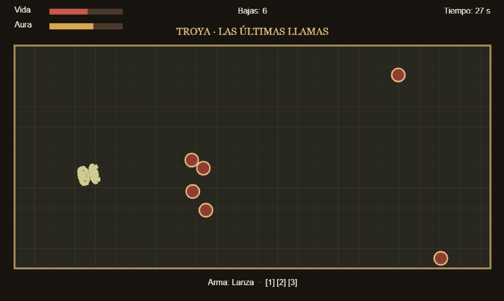

# La Aurisea

> **El regreso del héroe.** Una aventura de supervivencia inspirada
> libremente en la *Odisea* de Homero.

**Ligero Productions** · Proyecto universitario · Desarrollo en Phaser 3
y JavaScript

[](https://theligero.github.io/la-aurisea/)
[](https://github.com/theligero/la-aurisea)

------------------------------------------------------------------------

## Sobre el proyecto

**La Aurisea** es un proyecto universitario de desarrollo de videojuegos
que adapta libremente episodios de la *Odisea*. El jugador encarna a
Odiseo durante su regreso a Ítaca y debe sobrevivir a los peligros que
encuentra a lo largo del viaje.

El juego se plantea como una experiencia **2D de Horde / Arena Survival
para un jugador**. La propuesta de diseño contempla arenas cerradas,
cámara cenital fija, enemigos que aparecen desde distintos puntos del
escenario y un arsenal compuesto por espada, lanza y arco. El medidor de
aura forma parte del sistema de progresión y representa el avance del
héroe hacia su hogar.

El diseño completo, sus mecánicas y la propuesta de los seis escenarios
se encuentran en el [Documento de Diseño (GDD)](GDD.md).

> **Estado del proyecto — Hito 2:** primer prototipo jugable de la arena de Troya.
> Se ha sustituido la prueba de plataformas y estrellas por movimiento cenital,
> enemigos perseguidores, combate provisional con espada, lanza y arco,
> barras de vida y aura, temporizador y condición de victoria/derrota.
> Los otros cinco escenarios, los jefes, el arte definitivo y el sonido
> siguen pendientes. Consulta el [GDD](GDD.md) para el diseño previsto.

## Capturas

Añadir aquí capturas reales de la versión ejecutable. Se recomienda
guardar las imágenes en `assets/screenshots/` y mantener estos nombres:

| Pantalla | Archivo pendiente |
| --- | --- |
| Portada / página del proyecto | `assets/screenshots/portada.png` |
| Arena de Troya | `assets/screenshots/gameplay.png` |
| Prueba de combate | `assets/screenshots/gameplay-02.png` |

Cuando se incorporen las imágenes al repositorio, se pueden mostrar
directamente con:

``` md

```

## Jugar

La dirección prevista para la versión web publicada en GitHub Pages es:

**[Jugar a La Aurisea](https://theligero.github.io/la-aurisea/)**

No requiere instalación: se ejecuta desde un navegador compatible una vez
publicada la versión actualizada. Para probarlo en local es necesario abrir el
proyecto desde un servidor HTTP (por ejemplo, `python -m http.server`) debido
a los módulos JavaScript.

### Controles del prototipo

- **WASD o flechas:** moverse en ocho direcciones, con velocidad diagonal normalizada.
- **Ratón y clic izquierdo:** apuntar y atacar.
- **1 / 2 / 3:** espada, lanza y arco, respectivamente.
- **ESC:** pausar y continuar.

**Objetivo de Troya:** sobrevivir 45 segundos y terminar con un mínimo de
40 puntos de aura. Derrotar enemigos da 10 puntos de aura; recibir daño
reduce la vida y el aura. Son valores provisionales de prueba.

## Información del proyecto

| Campo | Información |
| --- | --- |
| Título | La Aurisea |
| Estudio | Ligero Productions |
| Autor | Ignacio Ligero |
| Tipo de proyecto | Trabajo universitario |
| Género | 2D Horde / Arena Survival |
| Modo | Un jugador |
| Plataforma prevista | PC / navegador |
| Tecnología | Phaser 3, JavaScript, HTML y CSS |
| Repositorio | [github.com/theligero/la-aurisea](https://github.com/theligero/la-aurisea) |
| Versión web | [theligero.github.io/la-aurisea](https://theligero.github.io/la-aurisea/) |

## Estructura del repositorio

``` text
la-aurisea/
├── assets/
│   ├── sprites/
│   └── screenshots/       # Capturas para la documentación
├── css/
│   └── game.css
├── docs/
│   └── ...                # Documentación y entregas anteriores
├── lib/
│   └── phaser.min.js
├── src/
│   ├── boot.js
│   ├── end.js
│   ├── enemy.js
│   ├── game.js
│   ├── level.js
│   └── player.js
├── index.html
├── GDD.md
├── assets.md
└── README.md
```

Los archivos gráficos `base.png`, `platform.png` y `star.png` se conservan
por ahora como recursos de la antigua plantilla, pero ya no se utilizan.
La estructura podrá ampliarse a medida que se incorporen nuevos sistemas.

## Tecnologías

-   **Phaser 3:** framework utilizado para ejecutar el juego en el
    navegador.
-   **JavaScript:** lógica y comportamiento del prototipo.
-   **HTML5 y CSS:** estructura y presentación de la página web.
-   **GitHub Pages:** publicación de la versión web.

## Documentación

-   [GDD --- Documento de Diseño de Videojuego](GDD.md)
-   [Assets --- Recursos, dirección artística y licencias](assets.md)

## Autores y créditos

**Ligero Productions**

-   Ignacio Ligero --- diseño y desarrollo del proyecto.

Los recursos externos y sus correspondientes autores/licencias se
detallan en [`assets.md`](assets.md). La atribución de herramientas y
librerías se mantiene conforme a sus respectivas licencias.

## Redes sociales

Por el momento, el proyecto no dispone de perfiles propios en redes
sociales.

## Aviso académico

Este videojuego se desarrolla como trabajo universitario con fines
docentes y de aprendizaje. No es un producto comercial. Las referencias
a la *Odisea* y a otras obras se realizan con fines de inspiración y
documentación del diseño.
